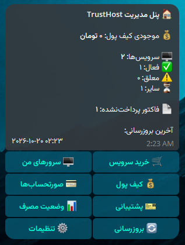

# TrustHost Telegram Management Bot

[](LICENSE)


> **Disclaimer:** This is an unofficial, community-built project. It is not affiliated with, endorsed by, or supported by TrustHost. "TrustHost" is a trademark of its respective owner. Use at your own risk and keep your API credentials private.

The **TrustHost client area, redesigned as a Telegram application**: dashboard, VPS control, traffic, renewals,
ordering, invoices, wallet, payments and support tickets – in **Persian and English** – built strictly on the official
**TrustHost Customer API 1.1.0**.

* Python 3.12 · aiogram 3 · httpx · Pydantic v2 · SQLAlchemy 2 (async) · Alembic · APScheduler
* Owner/admin-only, long polling (no inbound ports), secrets only in environment variables
* 262 automated tests (API client, services, Telegram flows, security, i18n, migrations)

> The API documentation is the single source of truth. Every route is mapped in
> [`docs/ENDPOINT_MATRIX.md`](docs/ENDPOINT_MATRIX.md); nothing undocumented is called or faked.

---

## Preview

<p align="center">
  
</p>
<p align="center"><em>Main dashboard (Persian UI): wallet, services, unpaid invoices and the main menu.</em></p>

---
## 1. Features

| Area | What you can do (all via inline-keyboard screens, with Back / Home everywhere) |
|---|---|
| Dashboard | Wallet balance, service counts (active / suspended), unpaid invoices – 3 cached requests |
| My Servers | Paginated list and detail (ID, product, type, domain, IP, status, cycle, price, next due) |
| Live status | Power state, vCPU, RAM, disk, IP |
| Power | on / off / shutdown / reboot. `off`, `shutdown`, `reboot` need confirmation (forced off shows a data-loss warning). The command is asynchronous, so the bot **polls the status** and never claims success before the API confirms it |
| Traffic | Used / quota / remaining / %, download vs upload, period, data status, last sync (only inbound counts toward the quota) |
| Usage | CPU, RAM, disk, uptime, period traffic and a text bar chart of daily traffic; 7 / 14 / 30 / 60 / 90 days |
| Traffic top-up | Package sizes **come from the API quote** (nothing hard-coded), promo preview, confirm, invoice |
| Renewal | Optional promo → confirm → issue-or-reuse the renewal invoice (the API prevents duplicates); friendly `NOT_DUE_YET` with the exact dates |
| Order a service | Groups → products → billing cycle → **options and custom fields rendered dynamically from the API** → optional hostname/domain/root password/gateway/promo → review → confirm → invoice |
| Invoices & payment | Filters (Unpaid / Paid / Cancelled / Refunded / All), wallet payment with confirmation and balance maths, online payment and USDT links as URL buttons |
| Wallet | Balance + the official **Add Funds** URL (the API has no deposit endpoint) |
| Support | Ticket list/detail/reply, new-ticket wizard (department → subject → message → priority → optional related service → review) |
| Notifications | Polling-based (the API has no webhooks): ticket replies, service status changes, payment/order status – de-duplicated and persisted |
| Settings | Language, notification preferences, account/API status, "unavailable features" |
| Diagnostics | `/health` – Telegram, database, TrustHost API, response time (never shows credentials) |

Commands: `/start /menu /servers /orders /invoices /wallet /usage /support /settings /help /cancel` (+ `/health`).
Command *syntax* is always English; only the descriptions are localized.

## 2. Architecture

```
Telegram handler  →  application service  →  TrustHost API client  →  TrustHost
(app/bot)            (app/services)          (app/trusthost)
```

```
app/
├── bot/            handlers/ keyboards/ states/ middlewares/ views.py ui.py callbacks.py setup.py
├── core/           config, logging (redacting), security, formatting, cache, operation guard
├── i18n/           fa.json, en.json, error translation layer
├── trusthost/      client.py (auth, success-check, limiter, retries), models.py, exceptions.py
├── database/       models, repository, session
├── services/       account, catalog, order, billing, server, traffic, ticket, notification, health, audit
└── main.py
tests/  alembic/  docs/  deploy/  Dockerfile  docker-compose.yml  .env.example
```

Handlers contain **no business logic and never call HTTP** – only services do, and only the client talks to TrustHost.
`services/container.py::Hub` is the single seam for adding per-user clients (multi-account) later; it is deliberately
*not* implemented now.

### Key behaviours (all covered by tests)

* **`success` is authoritative.** HTTP 200 with `success:false` is an error; HTTP 200 without the flag is a protocol error.
* **Errors**: 400 401 402 403 404 405 409 422 429 500 → typed exceptions → one translation layer
  (`translate_trusthost_error(code, lang)`); every documented error code has a Persian and English message. Raw JSON,
  tracebacks and HTTP codes are never shown. 402 adds the wallet top-up URL.
* **Rate limits** (60 req/min for keys without an IP allow-list): sliding-window limiter (default 50/min), `Retry-After`
  cool-down (no network calls while cooling down), single-flight coalescing of identical GETs, short TTL caches for
  catalog (5 min), services (30 s), invoices (20 s), tickets (30 s), wallet (10 s). Live data (status, traffic, power)
  is never cached. GETs retry with backoff on network errors/5xx; **POSTs are never retried after they may have reached
  the server**; 429 is never auto-retried.
* **Double-click / idempotency**: per-resource in-process guards on order, payment, renewal, top-up, power, ticket
  create/reply; confirmation screens re-check live state; the order draft disappears after submit; TrustHost's own
  duplicate protections (`is_duplicate`, existing renewal invoice, `INVOICE_NOT_UNPAID`) are surfaced honestly.
* **Security**: see below.

## 3. Security model

* `X-Reseller-Key` / `X-Reseller-Secret` exist **only** in environment variables → the HTTP client's headers. They are
  never put in messages, callback data, logs, the database, errors or Git. `SecretStr` + a logging filter masks
  `th_sec_…`, `th_res_…`, bot tokens and sensitive keys everywhere (tested, including exception tracebacks).
* **Owner/admin only**: only IDs in `ADMIN_TELEGRAM_IDS` may use the bot (startup fails if empty). Strangers get a
  localized "not authorized" message, no DB row, and no TrustHost call – nothing about your configuration leaks.
* **Root passwords** are requested in chat, the user's message is **deleted immediately**, the value lives only in
  in-memory FSM state until the order is submitted, is never logged and never written to the database (tested by
  scanning the SQLite file). Custom fields of type `password` get the same treatment.
* Callback data is compact (`≤ 64 bytes`, typed `CallbackData`), contains ids/short codes only, and every handler
  re-validates ownership through the account's own service list / API (TrustHost returns 404 for foreign resources).
* Audit log (`audit_log` table): who did what, on which resource, result code – never payloads or secrets.
* Restrict the API key to your server's IP in the client area (also lifts the rate limit).

## 4. Deployment

### 4.0 One-line installer (Debian/Ubuntu VPS)
Installs Docker if needed, clones the repo to `/opt/trusthost-telegram-bot`, asks for your keys (secrets are hidden and never logged), checks Telegram and TrustHost connectivity, and starts the bot.
```bash
curl -fsSL https://raw.githubusercontent.com/power0matin/trusthost-telegram-bot/main/install.sh | sudo bash
```
Prefer to read it first: [`install.sh`](install.sh). Pin a version with `TH_REF=v0.1.1`.

Non-interactive:
```bash
curl -fsSL https://raw.githubusercontent.com/power0matin/trusthost-telegram-bot/main/install.sh | sudo \
  TRUSTHOST_API_KEY=th_res_xxx TRUSTHOST_API_SECRET=th_sec_xxx \
  TELEGRAM_BOT_TOKEN=123456:xxx ADMIN_TELEGRAM_IDS=111111111 bash
```
| Task | Command |
|---|---|
| Update | run the same one-liner again |
| Change keys | `sudo bash /opt/trusthost-telegram-bot/install.sh --reconfigure` |
| Stop | `sudo bash /opt/trusthost-telegram-bot/install.sh --uninstall` |
| Logs | `cd /opt/trusthost-telegram-bot && docker compose logs -f bot` |

The bot needs outbound access to `api.telegram.org` and to the TrustHost API host.
### 4.1 Create the TrustHost API key
Client area → **Account → API Access** (`https://my.trusthost.ir/index.php?m=trusthost_bot`). Only the account owner can
create keys. You get `th_res_…` (key id) and `th_sec_…` (secret – **shown once**). Optionally restrict the key to the
bot server's public IP (*Manage IP*); an IP-restricted key has no request limit. You can hold up to 3 keys.

### 4.2 Create the Telegram bot
Talk to [@BotFather](https://t.me/BotFather) → `/newbot` → copy the token. Get your numeric user id from e.g.
[@userinfobot](https://t.me/userinfobot).

### 4.3 Configure
```bash
cp .env.example .env && chmod 600 .env
# set TRUSTHOST_API_KEY, TRUSTHOST_API_SECRET, TELEGRAM_BOT_TOKEN, ADMIN_TELEGRAM_IDS, POSTGRES_PASSWORD
```
| Variable | Meaning |
|---|---|
| `TRUSTHOST_BASE_URL` | default `https://my.trusthost.ir/api/v1` |
| `TRUSTHOST_API_KEY` / `TRUSTHOST_API_SECRET` | the API key pair |
| `TELEGRAM_BOT_TOKEN` | BotFather token |
| `ADMIN_TELEGRAM_IDS` | comma-separated Telegram ids allowed to use the bot |
| `DATABASE_URL` | `postgresql+asyncpg://…` (or `sqlite+aiosqlite:///./data/bot.db` for development) |
| `TRUSTHOST_MAX_REQUESTS_PER_MINUTE` | local limiter, default 50 (raise if your key is IP-restricted) |
| `NOTIFICATION_POLL_MINUTES` | default 5 (3 API requests per cycle) |
| `LOG_LEVEL`, `LOG_JSON`, `TRUSTHOST_TIMEOUT_SECONDS`, `DEFAULT_LANGUAGE` | optional |

### 4.4 Docker (recommended)
```bash
docker compose up -d --build        # postgres + bot; migrations run automatically on start
docker compose logs -f bot
```
PostgreSQL is not published to the host. Secrets come from `.env` only.

### 4.5 systemd on a plain Linux VPS
```bash
sudo useradd --system --home /opt/trusthost-bot --shell /usr/sbin/nologin trusthost
sudo mkdir -p /opt/trusthost-bot/data && sudo cp -r . /opt/trusthost-bot && cd /opt/trusthost-bot
sudo python3.12 -m venv venv && sudo venv/bin/pip install -r requirements.txt
sudo install -m 600 -o root -g trusthost .env /etc/trusthost-bot.env      # DATABASE_URL → your PostgreSQL
sudo chown -R trusthost:trusthost /opt/trusthost-bot/data
sudo cp deploy/trusthost-bot.service /etc/systemd/system/
sudo systemctl daemon-reload && sudo systemctl enable --now trusthost-bot
journalctl -u trusthost-bot -f
```
PostgreSQL: `CREATE USER … ; CREATE DATABASE trusthost_bot OWNER …;` then point `DATABASE_URL` at it.

### 4.6 Migrations
```bash
alembic upgrade head      # reads DATABASE_URL from the environment or .env (also done by Docker/systemd on start)
alembic check             # verifies models and migrations agree
```

### 4.7 Verify
1. Send `/start` to the bot → choose a language → the dashboard appears with your real wallet balance.
2. Send `/health` → Telegram ✅, Database ✅, TrustHost API ✅ with response time.
3. If the API is unreachable the bot still starts; the dashboard shows the localized error and the menu keeps working.

## 5. Development & tests
```bash
python -m venv venv && . venv/bin/activate && pip install -r requirements-dev.txt
pytest -q          # 262 tests, ~10 s, no network needed
```
Tests use a faithful fake TrustHost server (`httpx.MockTransport`, built from the documented routes, status codes and
sample payloads; it also checks the auth headers) and a fake Telegram transport that drives real updates through the
real dispatcher – so full conversations (order wizard, power confirmation, payment, tickets) are exercised end to end.

## 6. Limits that come from the TrustHost API (not the bot)
Honest limits – the bot says *"This feature is not available through the TrustHost Customer API"* instead of faking them:
no wallet-deposit endpoint (use the Add Funds URL), no OS reinstall, password/IP change, resize, DNS, profile editing
or cancellation; no single-invoice endpoint (the bot finds the invoice in the list); `/invoices` and `/tickets` return
**only the 20 most recent** records, so there is no deeper history or server-side pagination (the bot paginates those 20
locally); no webhooks, so notifications are polling-based; traffic data is collected periodically
(`last_synced_at` is shown); Persian error text from TrustHost is used only as a fallback for unknown error codes.

## 7. Documentation gaps and how they are handled
The spec leaves a few nested shapes open. The bot never invents values; it parses defensively and degrades visibly:

| Gap in the API docs | Handling |
|---|---|
| `Product.pricing` shape is undocumented (`{}`) | Cycle prices are extracted if recognisable (dict keyed by cycle, scalar or `{price/amount/total}`); otherwise all four documented cycles are offered without a price. The authoritative price is always on the invoice (stated on the review screen); a valid promo preview shows exact original/discount/final amounts |
| `config_options[].type`, `sub_options[]` fields beyond `id` | WHMCS convention: type `4` = quantity (numeric prompt); an option without sub-options is treated as quantity; sub-option label from `name` (fallbacks: `optionname`, `label`, `value`, id). Every option has "skip (use default)" |
| `custom_fields[]` types | `dropdown` → buttons from comma-separated `fieldoptions`; `tickbox` → Yes/No (sends `on`); everything else → text (`password` fields are masked and deleted). Fields are skippable unless the API marks them `required` |
| `daily_traffic.items[]` shape (`[{}]`) | Date / inbound / outbound located by several key aliases; unrecognised data shows a notice instead of crashing |
| `INSUFFICIENT_CREDIT` "with the amounts" (no field names) | The bot computes amounts itself from `/wallet` + `/invoices` before asking for confirmation |
| Invoice `credit` semantics | If `credit > 0` the payable estimate is `total − credit`; the exact paid amount is shown from the API response |
| Services that are not virtual servers | VM buttons are shown for every service; the API's `NOT_SUPPORTED` is translated if used on a non-VM |

If TrustHost publishes these shapes, tighten the parsers in `services/catalog_service.py`, `services/traffic_service.py`
and `trusthost/models.py`.

## 8. Operational notes
* FSM state is in memory: a restart discards in-progress wizards (the user sees "session expired" and starts again) and,
  as a benefit, drops any pending root password. Use a Redis FSM storage if you need wizards to survive restarts.
* The bot is single-instance (long polling). Do not run two copies with the same token.
* Dates are shown as `YYYY-MM-DD HH:MM` in server time (Asia/Tehran), with Persian digits in the Persian UI; money is
  Toman with a thousands separator (`۱٬۳۵۰٬۰۰۰ تومان` / `1,350,000 Toman`).
